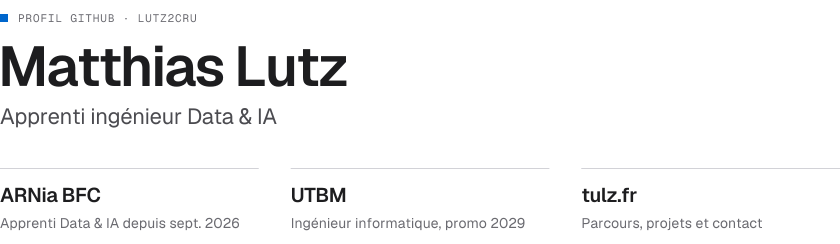

<picture>
  <source media="(prefers-color-scheme: dark)" srcset="assets/header-dark.svg">
  
</picture>

<br>

Élève ingénieur en informatique par apprentissage à l'UTBM. Je travaille à
l'ARNia BFC, l'agence régionale du numérique et de l'IA de
Bourgogne-Franche-Comté, qui accompagne les collectivités dans leur
transformation numérique.

## Actuellement

- Intégration et déploiement d'un assistant conversationnel basé sur du RAG hybride
- Contribution à une plateforme régionale de données publiques
- Apprentissage approfondi de Python, des API REST et des architectures LLM/RAG

<picture>
  <source media="(prefers-color-scheme: dark)" srcset="assets/pipeline-dark.svg">
  
</picture>

## Projets

| Projet | Description | Stack |
|---|---|---|
| [Projet-LO21-A25](https://github.com/lutz2cru/Projet-LO21-A25) | Système expert : base de règles et moteur d'inférence à chaînage avant | C |
| [Projet-LP25](https://github.com/JulesGIT2/Projet-LP25) | Moniteur de processus inspiré de htop, en local et sur hôtes distants (projet d'équipe) | C, ncurses |

<!--
À réactiver quand le repo aura un vrai README :
| [station_meteo_groupe7_a25](https://github.com/lutz2cru/station_meteo_groupe7_a25) | Station météo ESP32 : capteurs, firmware, supervision et dashboard Node-RED | C++, MQTT, Node-RED |
| [resume-matthiaslutz](https://github.com/lutz2cru/resume-matthiaslutz) | CV en ligne | HTML, CSS |
-->

## Outils

```
maîtrisés     Linux · Bash · Git · SQL · HTML/CSS/JS · C · MQTT · Node-RED · ESP32
en cours      Python · API REST · LLM · RAG · bases vectorielles
```

## Contact

[tulz.fr](https://tulz.fr) · [LinkedIn](https://www.linkedin.com/in/matthias-lutz1/) · [matthias@tulz.fr](mailto:matthias@tulz.fr)
